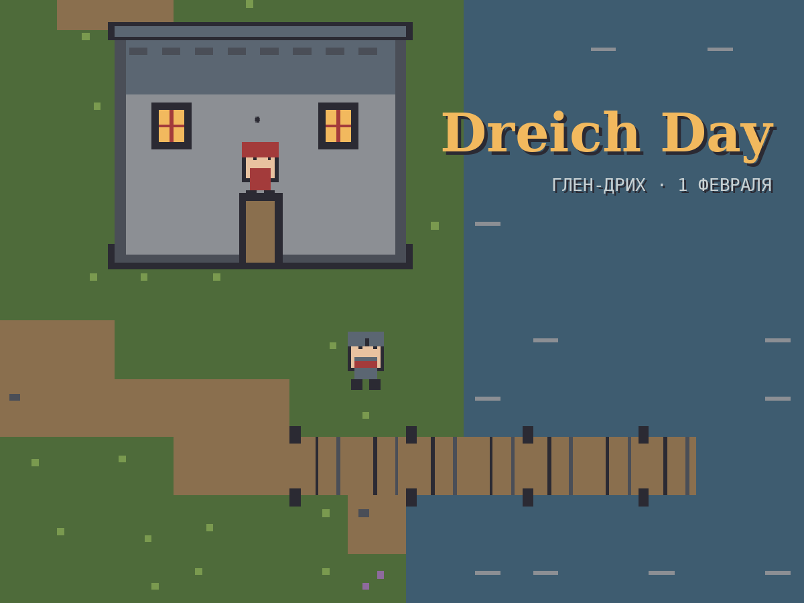

# Dreich Day

Уютная пиксельная 2D-игра о временной петле в шотландской деревне Глен-Дрих.
Лондонский синоптик Оливер Оверкаст застревает в Дне святой Бригиты: день повторяется, но погода, события и настроение жителей каждый раз выпадают заново. Игрок разгадывает скрытые правила, по которым живёт деревня, пишет прогноз для местной газеты, мирит жителей и готовит команду «Гадюки Глен-Дриха» к финальному матчу по шинти, чтобы спасти паб от сноса.

**Играть:** https://websim.com/@IndianaKussers/dreich-day



## О проекте

Большое домашнее задание по дисциплине «Генеративный искусственный интеллект: модели и приложения» (НИЯУ МИФИ, преподаватель А. А. Кузьмин).
Игра разработана методом вайбкодинга на платформе [WebSim](https://websim.com): код пишет агент WebSim по промптам, техническое задание, промпты и пиксельная графика подготовлены с помощью генеративного ИИ.

Автор: Лобанов Алексей Игоревич, группа Б25-527. Работа также представляется для зачёта в качестве проектной практики.

## Что есть в игре (версия v27)

- Цикл дня 6:00–18:00 (1 игровой час = 50 секунд), временная петля с сохранением дневника.
- Случайные условия дня: погода утром и после полудня, знак гадюки Натайр на утреннем обряде, событие дня.
- 11 жителей деревни, у каждого расписание и 1–2 скрытых правила вида «условие → поведение».
- Прогноз в утренней газете: жители строят по нему планы, а погода его проверяет.
- Дневник: наблюдения, открытые правила, задания, истории.
- 10 заданий дня с фильтром выполнимости.
- Истории и конфликты: «Старые друзья» (Дуги и Ангус), «Подкупленный судья» (разоблачение Руперта Скуннерсби), «Пикша и булки», «Псалмы и волынка».
- Финальный матч по шинти в 16:00: лист команды с модификаторами, формула силы, мини-игра 6 на 6 (итерация 4).
- Концовка после победы (решающий гол должен забить Оливер), титры, меню «Продолжить / Новая игра / Как играть», подсказки в первой петле, простые звуки (M — вкл/выкл) (итерация 5).

> В `game/game.js` уже внесены два исправления после плейтеста v27 (запуск новой игры и удары Оливера), описанные в `prompts/10_iter5_fix_pending.txt`; в WebSim они будут отправлены агенту отдельным запросом.

## Управление

WASD / стрелки — ходьба, E — говорить / взаимодействовать, J — дневник, Esc — закрыть окно.
В матче: WASD / стрелки — бег, Пробел — пас, E — удар.

## Структура репозитория

| Папка | Содержимое |
|---|---|
| `game/` | Код игры, выгруженный из WebSim (`index.html`, `style.css`, `game.js`) и все спрайты (`game/assets/` — поле и игроки Силлерберна) |
| `docs/` | Комплект документации по ЕСПД (ГОСТ 19.101-77, 19.106-78) в LaTeX и PDF: техническое задание (`tz`), спецификация требований (`srs`), пояснительная записка по ГОСТ 19.404-79 (`pz`) с журналом разработки |
| `prompts/` | Промпты для агента WebSim по итерациям |
| `art/` | Python-скрипты (Pillow), которыми рисовались спрайты, и превью |
| `screenshots/` | Скриншоты версий |

## Запуск локально

Игра — статический сайт, ей нужен любой локальный веб-сервер (из-за загрузки спрайтов):

```bash
cd game
python -m http.server 8000
```

Затем открыть http://localhost:8000.

## Сборка документации

```bash
cd docs
xelatex tz.tex && xelatex tz.tex
xelatex srs.tex && xelatex srs.tex
xelatex pz.tex && xelatex pz.tex
```
Нужны шрифты Liberation Serif / Liberation Mono.
